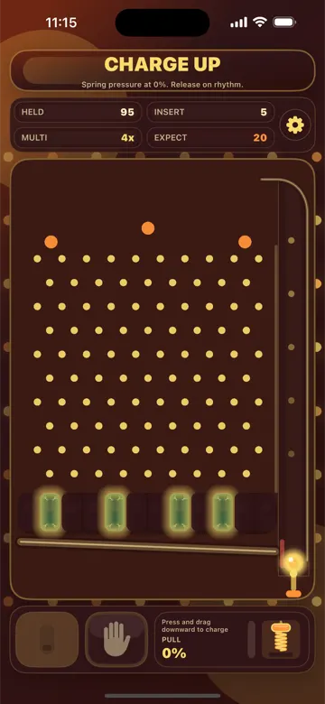
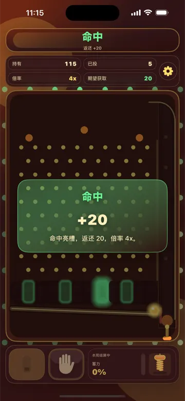
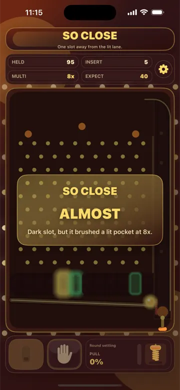

  

<h1 align="center">Pocket Pinball</h1>

  iPhone 竖屏街机弹珠游戏 · Portrait arcade pinball for iPhone 
  <a href="https://pinball.vanjay.cn/">主页 / Website</a> ·
  <a href="https://github.com/wangwanjie/PinballMachine/releases/latest">下载 / Download</a> ·
  <a href="README.en.md">English</a>

  
  
  

## 简介

Pocket Pinball 是一款竖屏街机弹珠游戏：投珠、锁倍率、拉弹簧，把钢珠砸进亮槽。

- **一局的流程**：投珠（至少 5 颗）→ 机台锁定倍率并点亮若干槽位 → 下拉弹簧蓄力、松手击球 → 钢珠穿过钉阵落入亮槽即命中，按倍率返还弹珠。结果分为「命中」「差一点」「落空」。
- **机台氛围**：9 套机台皮肤、8 种背景音乐、8 种音效风格；皮肤只改变灯光与配色，玩法一致，部分皮肤会同步更换主屏幕图标。默认免费：晴空街机、午夜霓虹两套皮肤，霓虹脉冲、糖弹跳跳两首音乐，玻璃电流、果冻弹珠两种音效（免费范围可由远程配置调整）。其余内容通过应用内「永久解锁」一次性开启。
- **弹珠规则**：弹珠少于 100 颗时可重置为 100 颗；每日免费重置普通 3 次，永久解锁后 6 次。
- **无需账号**，进度保存在本机。界面语言：简体中文、繁體中文、English。

## 下载与安装

| 项目 | 说明 |
| --- | --- |
| 版本 | 1.0（构建 1） |
| 系统要求 | iPhone，iOS 15.0 或更高 |
| 安装包 | [PocketPinball.ipa](https://github.com/wangwanjie/PinballMachine/releases/latest/download/PocketPinball.ipa)（约 2.9 MB） |
| 签名 | Ad Hoc（描述文件有效期至 2027-04-05） |

**安装限制（请先阅读）**

1. 这是 App Store 之外的分发版本，安装包使用 Ad Hoc 描述文件签名，只有 UDID 已登记在该描述文件中的设备才能直接安装；其他设备安装会失败。
2. 已登记设备：用 Mac 上的 Finder 或 Apple Configurator，把 IPA 拖到已连接的 iPhone 上安装。
3. 未登记设备：可以尝试用 AltStore、Sideloadly 等工具以自己的 Apple ID 重新签名后安装，能否成功取决于工具与账号，这里不作保证；免费 Apple ID 签名通常 7 天后需重新签名。
4. 描述文件在 2027-04-05 过期，之后已安装的副本将无法打开，需要换用新的安装包。
5. 应用内购买在这种分发方式下走 Apple 沙盒环境，无法真实付费；默认免费的皮肤、音乐与音效可以直接游玩。

## 隐私

- 语言、音频、外观、弹珠数量、每日重置计数和安装标识保存在设备本地。
- 启动时向 RCPlatform 拉取运行时配置（隐私政策链接、免费内容、重置策略等），请求中带有应用版本与本地生成的安装标识。
- 购买与恢复购买由 Apple StoreKit 处理，应用不接触支付卡信息。

完整说明见 [隐私政策](https://pinball.vanjay.cn/public/privacy-policy.html)，技术支持见 [支持页面](https://pinball.vanjay.cn/public/support.html)。

## 反馈

问题与建议请提交到 [Issues](https://github.com/wangwanjie/PinballMachine/issues)，或发邮件至 vanjay.dev@gmail.com。

更多作品：[vanjay.cn](https://vanjay.cn)

© 2026 VanJay
